<!-- Generated by scripts/render_cards.py. Edit profile.json, then render. -->

  
  
  

Flutter · Dart · Kotlin · BLoC · GetX · Figma 
<a href="mailto:dev.aqeelali@gmail.com">Let’s build something useful.</a>

